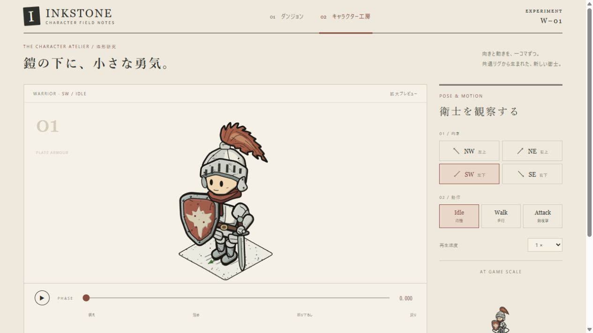

# Inkstone 重装戦士制作実験 — 灰燼の衛士

> この文書は制作時点の記録です。本文中の旧ファイル名・コマンド・起動先は当時のものを含みます。現在の構成と手順は [README](../../../README.md) を参照してください。画像・資料への相対リンクは整理後の配置へ更新しています。

実施日: 2026年10月12日（日本時間）  
対象: Inkstone v0.1.0 / Canvas 2D  
制作者・技術検証・画像評価: 制作AI。**人間による主観評価は未実施。**

既存の描画基盤を利用して、新規キャラクター「灰燼の衛士 / The Cinder Guard」と、操作できる8×8ダンジョンを追加した。既存 `src/` 29ファイルのSHA-256を着手前と比較し、変更0件を確認した。新しい人体リグ、投影エンジン、シーン描画器、キャッシュエンジンは作っていない。

技術的な成立と、美術的な完成度は別の判断とする。操作と描画は検証できた。造形は参考画像の特徴を取り込めたが、原画の不規則で緻密なペン画より整理された表現であり、同等の魅力を保証するものではない。

## 起動と確認

```powershell
node tools/serve.mjs 8081
```

[デモを開く](http://127.0.0.1:8081/) / [実ブラウザ検証ページ](http://127.0.0.1:8081/check.html)

Node.js 18以上。依存パッケージのインストールは不要。`npm start` でも起動可能。ポート使用中なら別の番号を渡す。ES Modulesを使用するため、`index.html` を `file://` で直接開かず、既存サーバーから開く。

- **ダンジョン:** 床をクリックして移動。W=NE、A=NW、S=SW、D=SE。キーは1押下1マス。Spaceで現在の向きへ攻撃。
- **キャラクター工房:** 4方向、Idle / Walk / Attack、再生・停止、位相、再生速度、拡大と実ゲーム表示倍率の比較。
- **12パターン一覧:** 工房の一覧ボタンから表示。各動作の周期に対する同じ位相を比較できる。
- **描画方式:** 下部のLive Vector / Cached Frames。初回生成時には同期処理による短い停止がある。
- **技術情報:** 下部の折り畳みを開くと、ゲーム状態、カメラ、キャッシュ、エラーをJSONで確認できる。
- **透視表示:** 初期値OFF。純粋な遮蔽を確認でき、必要ならONにできる。

ゲームロジックの再検証:

```powershell
node --test game/verification/game.test.mjs
```

描画検証は `check.html` の「検証を実行」から実行し、結果JSONを保存できる。

## A. 完成した戦士

銀灰色の大型兜、角のある縦の通気孔、赤茶のプルーム、暗赤色のスカーフ、重ねた板金鎧、大きな紋章盾、直剣を制作した。顔は縦長の目と小さな口だけに整理し、金属と布・革の色を分離した。既存の緑フード剣士とは、頭、配色、胴体、装備の輪郭が明確に異なる。

頭部の最終修正では、羽を頭身に含めた初期評価を改めた。兜・顔を含む頭部の縦寸法を約41ローカルpx、羽を除いた頭頂から靴底までを約100pxに調整し、見た目で約2.4〜2.5頭身を狙った。3頭身寄りではなく、依然として頭が大きい。腕と脚の長さを伸ばして帳尻を合わせていない。

| 動作 | 周期 | 内容 | キャッシュ |
|---|---:|---|---:|
| Idle | π秒 | 小さな呼吸、羽とスカーフの揺れ、瞬き | 20コマ/方向 |
| Walk | 約0.714秒 | 共通の交互歩行、抑えた胴の上下動、装備の連動、遅れる羽 | 16コマ/方向 |
| Attack | 1.35秒 | 引き・溜め・上体の捻り・短い振り下ろし・戻り | 24コマ/方向 |

NW / NEは兜の後頭部と首の重ね板を描き、SW / SEは顔と通気孔を描く。盾は前面が赤茶の塗装・銀の縁・独自の翼ある太陽風の紋章、裏面が木板・革帯・把手。**解剖学的な左手に剣、右手に盾を保持し、全身ミラーで持ち替えていない。**

参考画像に対して、羽根の房と鎧の継ぎ目を整理し、顔をより丸くした。原画の紋章や全輪郭をトレースしていない。参考画像は画面や成果物へ貼り込んでいない。画像生成AI、外部画像、外部フォント、外部ライブラリは未使用。



## B. Inkstoneライブラリの再利用

着手時に指定の4ガイド、`index.js`、`authoring.js`、`rig.js`、`swordsman.js`、`registry.js`を読み、描画・キャッシュ・人物部品の実装も確認した。

| 用途 | 再利用したAPI・仕組み |
|---|---|
| 登録 | `createCharacterRegistry().register()`、`renderer.registerCharacter()`、`validateCharacter()` |
| 部屋 | `createRenderer()`、`setRoom()`、既存のRoomData、柱・宝箱・樽・木箱の描画 |
| カメラ | `fitToRoom()`、`resize()`、`getCamera()`、`eventToWorld()` |
| 共通骨格 | `rigFrame()`、`UY`、`ik2()`、`walkFeet()`、`legParts2()`、`footProj()` |
| 前後関係 | `renderRig()`、`bodyLayerKey()`、`yawToBody()`、`LAYER`、Renderer内部の床占有範囲ソート |
| 手描き表現 | `paint / paintA`、`LW`、`roughen`、`cLine`、`stipplePoly`、`rimWeight`、`taperPts`、`mittenHand`、`fillPoly`等 |
| アニメーション | `keyframes()`、`nrm3()`、`vlerp()`、共通歩行周期 `WALK_HZ` |
| 接地同期 | `walkSecondsPerTile(1.25)` = 約1.68359秒/マス。歩行距離からアニメ時刻を生成 |
| プレビュー | `createCharacterView()`、`render()`のclip、`setScale()`、`setMode()` |
| キャッシュ | 定義のactions / keys / frameBox、既存Renderer / CharacterViewのストア、`prepareCaches()`、`getDiagnostics()`、`disposeCaches()` |

経路の点や目的地の枠もRendererの`floorOverlay`内から公開の`dot()`、`dashedCell()`を利用した。部屋やキャラを描くための別Canvasエンジンは置いていない。

## C. 新規実装

| ファイル | 担当するもの |
|---|---|
| `game/characters/warrior.js` | 戦士専用のポーズ、兜・羽・鎧・剣・盾、方向別補正、登録定義 |
| `game/dungeon.js` | 8×8部屋のデータと初期位置 |
| `game/game.js` | 4近傍BFS、占有マス、状態遷移、歩行距離、攻撃予約 |
| `game/controls.js` | ポインタ入力、キー、フォーカス・blur・リピート抑制 |
| `game/main.js` | 公開Renderer / CharacterViewとゲーム・UIの接続 |
| `game/style.css` / `index.html` | 広間・工房・位相操作・サイズ比較・描画方式のUI |
| `check.html` / `game/verification/` | ブラウザ描画検証、純ロジック検証、結果・画像証跡 |
| `package.json` | ES Modules宣言と依存なしの起動・テストコマンド |

鎧は、下地布・胸当ての明暗面・腰の重ね板・分割した腿当て・肩の二枚板・前腕の装甲・膝当て・ブーツの甲を重ねた。金属には細い傷と点描、革には暗い茶と留め具を用いた。

攻撃の左手位置と剣先は同じポーズに結合している。IKの肘と手が異なる奥行き層にある場合は、既存弓使いと同様に前腕の描画を分割した。SE / NWでは大兜に隠れる振りかぶりを外へ開き、NEでは攻撃中に盾を右手位置のまま内向きに回した。いずれも視認性のための造形補正であり、別の骨格や持ち手への付け替えではない。

部屋には扉1、松明3、柱2、宝箱1、木箱1、樽1を配置した。占有5マスを除く59マスは全て初期位置から到達できる。ゲームは敵・HP・ダメージ・宝箱開封を持たない、操作と描画の実験である。

## D. ライブラリの問題点と回避策

### 技術的な制約

1. **体格をパラメータで指定するAPIがない。** `legParts2()`は腰高z=21、腰幅±6.5等が固定。`BODY_SHAPE`も頭中心z=67・半径17、胴の近似寸法が固定である。新しい低頭身・大兜に遮蔽判定が完全一致するわけではない。既存の骨格を維持し、頭部の描画位置と大きさ、鎧の重なりで対応した。
2. **`ik2()`は到達不能の手をエラーにしない。** 肘を算出するときの距離を制限するが、元の手位置までは戻さないため、使い方によって前腕が伸びる。手のキーフレームを修正し、描画時の肩・肘・手の長さをブラウザ検証へ追加した。
3. **`paint()`の丸めは細い角穴にも作用する。** 初版の兜の通気孔は楕円に見えた。通気孔だけを公開`fillPoly()`と`roughen()`で描き、共通の塗りを置き換えずに対処した。
4. **キャッシュはインスタンスごとに独立し、同期生成する。** 部屋・拡大・通常サイズは別の倍率のコマを必要とする。工房の12パターンは1つのCharacterViewとclipを共有し、12個のストアを作らないようにした。タブ移動で隠れたビューのキャッシュを解放し、Liveへ戻る際も破棄する。拡大プレビューはDPR=1、部屋は端末DPR（上限2）を使用する。
5. **透視表示はピクセル単位の遮蔽判定ではない。** 大きなframeBoxと小物の外接矩形が重なっただけでも透視候補になる。戦士が柱の前でほぼ全て見えている場面でも候補に残ることがあった。初期値は透視OFFとし、チェックボックスから既存機能を使えるようにした。
6. **ガイド内の過去サンプルへのリンク先が、この配布内容にはない。** `examples/`や過去のテストへの参照はあるが実体は配布されていない。公開コードを読んで確認用アプリと検証ページを追加した。

### 美術上の工夫との区別

大盾を大きく見せる、兜を丸める、羽の輪郭を房状にする、剣の構えを外へ開くことは作者側の美術判断である。固定リグやキャッシュ管理の不足とは区別する。NEの振り下ろしでは大盾に刃の一部が隠れ、原画のような全装備の見栄えを全位相で維持できてはいない。

**不可避だったライブラリ修正: なし。`src/`変更0件。**

## E. 制作過程

初版をブラウザへ統合した後、キャラクターを5段階修正した。

| 段階 | 発見した問題 | 修正 |
|---|---|---|
| 1 | 攻撃終端で肩から手が腕長24.1pxを超え、前腕が伸びる | 手のキーをIK可動範囲へ戻した |
| 2 | 金属が滑らか、羽が葉のよう、通気孔が丸い | 点描と微小傷、37頂点の羽縁と流線、角形ベント |
| 3 | SE / NWの振りかぶりが兜に隠れる。NEの盾が刃を隠す。瞬きがcache key間へ落ちる | 向き別の手・刃・盾の補正、軌跡を追従、瞬き位相の修正 |
| 4 | 最初の補正でもSEでは剣先しか見えない | IK範囲内で振りかぶりの手をさらに外へ開いた |
| 5 | 羽を含めた頭身の判断は不適切で、兜が胸板を隠す | 頭部中心z=64→72、頭一式0.9倍。胸板を露出させた |

アプリ側では画面高へのフィット、拡大キャッシュの容量、描画方式の連続切替、ページの「戻る」で復元される場合のリソース破棄をレビューして修正した。既存サーバーはsandbox内起動時にブラウザから到達できなかったため、同じサーバーをlocalhostの8081で起動し直した。サーバーコードやOSのセキュリティ設定は変更していない。

計測した作業開始: **04:26:13 JST**。終了時刻と実経過時間は本書末尾の最終記録に記す。複数の制作・検証エージェントを並行利用しており、時間は人数分を足した工数ではない。

## F. 技術検証

環境はWindows、Node.js 24.13.1、Codex内蔵ブラウザのChromium 155、表示DPR=1。ブラウザを実際に起動し、UIをクリック・キー操作して確認した。外部通信は行わず、localhost上のファイルを読み込んだ。

### 操作と部屋

| 項目 | 結果・根拠 |
|---|---|
| 8×8、必要な建物と小物 | 実画面で確認。部屋はRoomDataから既存Rendererが描画 |
| WASD | 画面のCELL 05/06→W:05/05→A:04/05→S:04/06→D:05/06、および向きを確認 |
| クリック経路・到着 | Cachedで初期位置(4.5,5.5)から床(5.5,2.5)へクリック。4マスの経路を終え、正確な中心・idle・空の経路へ復帰 |
| 障害物 | 上記到着点からSで柱[5,3]へ入力。位置は不変、「壁や障害物のマスへは移動できません」を確認 |
| Space | Liveで剣攻撃。CachedでW直後のSpaceを検証し、次の中心で攻撃、その後NE向きのidleへ復帰 |
| 再目標・攻撃中入力 | 純ロジック検証で、進行中セグメントを維持した再目標、角抜け防止、攻撃中の移動拒否、状態復帰を確認 |
| 柱の前後 | 実ブラウザでRendererの描画順と実ピクセル遮蔽を検証。前後の並びが逆転する |
| 小物の奥行き | 宝箱・木箱・樽の前後で描画順を確認 |
| Live / Cached | UIで切替、拡大・通常サイズ・ダンジョン・一覧で描画。キャッシュ表示の警告なし |
| プレビューUI | 方向、3動作、停止、位相0.38/0.55、一覧、通常サイズ比較を操作 |

証跡: [クリック到着](click-movement.json)、[柱への移動拒否](blocked-movement.json)。これらのJSONは頭部比率の最終調整前に取得したが、入力・ゲームロジックは同一である。

### 描画の自動検証

`check.html`は、各cache keyとその間の中間位相を含む**480個のLiveサンプル**、**240枚のCached Frames**を実Canvasで描く。空画像、frameBoxからのはみ出し、手の解剖学的左右、腕長、全64セルの座標逆変換、柱・小物の前後関係を確認する。結果は[最新のブラウザ検証JSON](browser-results.json)に保存する。

ゲームロジックは9項目通過。描画検証は最終記録の件数を参照。検査は重要な位相と中間点の標本であり、連続時間の全ての位相を数学的に証明するものではない。alpha境界は共通影も含み、alpha≤2は除外している。

### キャッシュ

定義は20＋16＋24コマ×4方向 = **240コマ**。攻撃キーは次の通り。

```text
0 .06 .12 .20 .27 .33 .38 .42 .45 .47 .49 .51
.53 .55 .58 .62 .67 .72 .77 .82 .87 .92 .96 .99
```

振りかぶり終端と振り下ろしの周辺を密にした。`frameBox = {x0:-86, x1:86, y0:-130, y1:29}`。コマ生成・取得・破棄は既存ストアに任せている。

画面上の計測例（DPR=1、240枚、頭身修正前の同一frameBox）:

| 対象 | 倍率k | 1コマ | RGBA理論容量 | 生成時間 |
|---|---:|---:|---:|---:|
| 広間870×440 | 0.4727 | 82×76px | 5,982,720 B / 5.71 MiB | 約403 ms |
| 拡大プレビュー | 2.4154 | 416×385px | 153,753,600 B / 146.63 MiB | 約386 ms |
| 通常サイズ比較 | 0.4727 | 82×76px | 5,982,720 B / 5.71 MiB | 約365 ms |

原本は[工房の診断値](atelier-diagnostics.json)。最終造形の固定倍率測定は最新ブラウザ検証JSONおよび末尾に記載する。時間はその環境での一回の観測で、厳密なベンチマークではない。

**容量は幅×高さ×4の理論値であり、GPUの複製やブラウザ管理領域を含む実メモリではない。** 拡大ビューは高コストである。部屋用だけの容量をアプリ全体の容量と解釈してはいけない。12パターン一覧のストアは1組だが、追加で約60 MiB必要になる。画面サイズが変われば倍率・容量・生成時間も変わる。

## G. ビジュアル評価

以下は実ブラウザ画像を見た制作AIの評価であり、人間による評価ではない。

| 観点 | 成立した点 | 改善の余地 |
|---|---|---|
| シルエット | 大兜・赤い羽・大盾・短い脚で重装戦士と判別できる | 原画の盾はより長く角ばり、装備の輪郭も複雑 |
| 体型 | 最後に頭部を調整し、胸当てと腰の層が読める | 3頭身には達しておらず、丸い印象が強い |
| 金属 | 明暗面、重ね板、鋲、傷、点描で平坦な灰色から改善 | 肩・小手の丸みが強く、実際の板金の硬さは簡略化される |
| 羽 | 後頭部でも形が読み取れ、足・体より遅れて揺れる | 房ごとの独立した二次運動はなく、少数の輪郭変形 |
| 盾・剣 | 盾表裏を描き分け、手から装備が離れない。振りかぶりを改善 | NEの振り下ろしでは盾による刃の隠れが残る |
| 顔 | 開いた顔と単純な目・口が親しみやすい | 参考画像より柔らかく、精悍さは弱い |
| 手描き感 | 共通の線幅階層、揺らぎ、点描を使用 | 原画ほど細密で不規則な筆致ではなく、輪郭が整っている |
| 通常サイズ | 赤・銀・盾の形は小さくしても残る | 8×8全体を低い画面へ収めると高さ約60pxになり、細密傷や目は読みにくい |

歩行は接地補正と距離同期を維持しており、脚の左右交代を画像でも確認した。ただし、全方向の長時間動画を人間が見て接地感・重量感を判定したわけではない。方向転換はマス中心で即時に4方向を切り替えるため、旋回専用アニメーションはない。停止時の専用ブレンドもなく、さらに自然にする余地がある。

## H. 今後のキャラクター制作への示唆

**別の制作者が、Inkstoneを置き換えずに新しい職業を追加することは可能だった。** APIから登録・シーン・プレビュー・キャッシュまで接続でき、線画の共通スタイルも保てる。

一方で、初見の作者が登録例だけを読む作業では完結しなかった。大型装備と異なる頭身では、リグの固定寸法、IKの到達範囲、描画層の近似形状まで読む必要があった。再利用性は高いが、自由な体格を簡単に指定できる段階ではない。

- 魔法使いは、同じ骨格に衣装・帽子・杖・詠唱キーを追加する方法が見込める。長い杖と帽子の重なりには方向別補正が必要。
- 別の重装戦士は、鎧・盾・色・武器を変更して展開しやすい。攻撃中の盾と刃の可視性を初期段階で確認すべき。
- 人型の敵は同様に追加できる。極端な体格や多脚の敵へ同じ人体リグを無理に適用できるとは言えない。
- ライブラリ改善として、体格設定、到達可能な手位置の検査、frameBox自動検査、キャッシュの非同期準備、配布に含まれる最小制作サンプルがあると作者の負担が減る。

次の評価では、人間に通常サイズの探索・攻撃を見てもらい、「一緒に冒険したいか」「重装の重さを感じるか」を確認する必要がある。テスト成功数をその代わりにはしない。

## 最終記録

最終造形のブラウザ検証: **51項目成功 / 0失敗**（2026-10-12 04:51:56 JST開始、19.958秒）。Live 480位相、Cached 240枚で、frameBoxからの切れ0件、腕の長さの変化0件、左右の保持違反0件。コンソールのwarning / errorも0件だった。4方向×3動作を最終画像で再確認した。

柱の背後では約85%の人物ピクセルが隠れ、手前では約98.5%を保持した。宝箱・木箱・樽でも前後の描画順を確認した。これらは技術検証であり、魅力や重量感の主観的な合格を意味しない。

最終造形のキャッシュ実測（DPR=1、各240枚）:

| 条件 | 1コマ | RGBA理論容量 | 生成時間 |
|---|---:|---:|---:|
| 固定倍率k=1 | 172×159px | 26,254,080 B / 25.04 MiB | 350.6 ms |
| 検証用960×680の部屋、k=0.7573 | 131×121px | 15,216,960 B / 14.51 MiB | 340.0 ms |

値は人物キャッシュ単体であり、部屋・小物・影のキャッシュは別。結果原本は[ブラウザ検証JSON](browser-results.json)、ソース不変の記録は[SHA-256照合](source-integrity.json)。最終画像は[4方向の待機・歩行](final-directions.jpg)、[歩行・攻撃](final-actions.jpg)、[工房](warrior-atelier.jpg)、[ダンジョン](warrior-dungeon.jpg)に保存した。

完了記録: **04:52:56 JST**。着手04:26:13からの観測実経過は**26分43秒**（並行作業を含む）。造形修正5回、既存 `src/` の修正0件。人間による主観評価は未実施。
