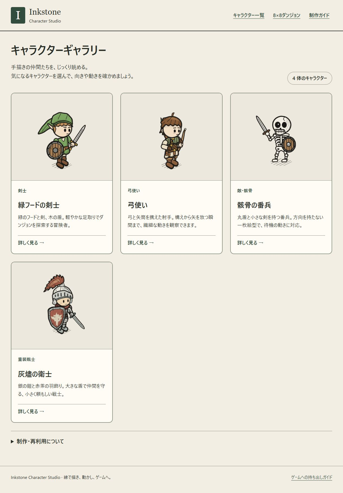
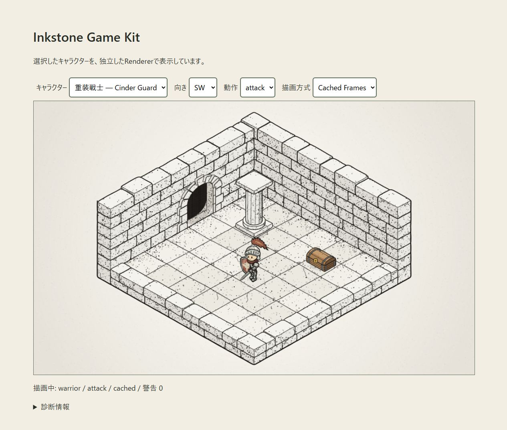
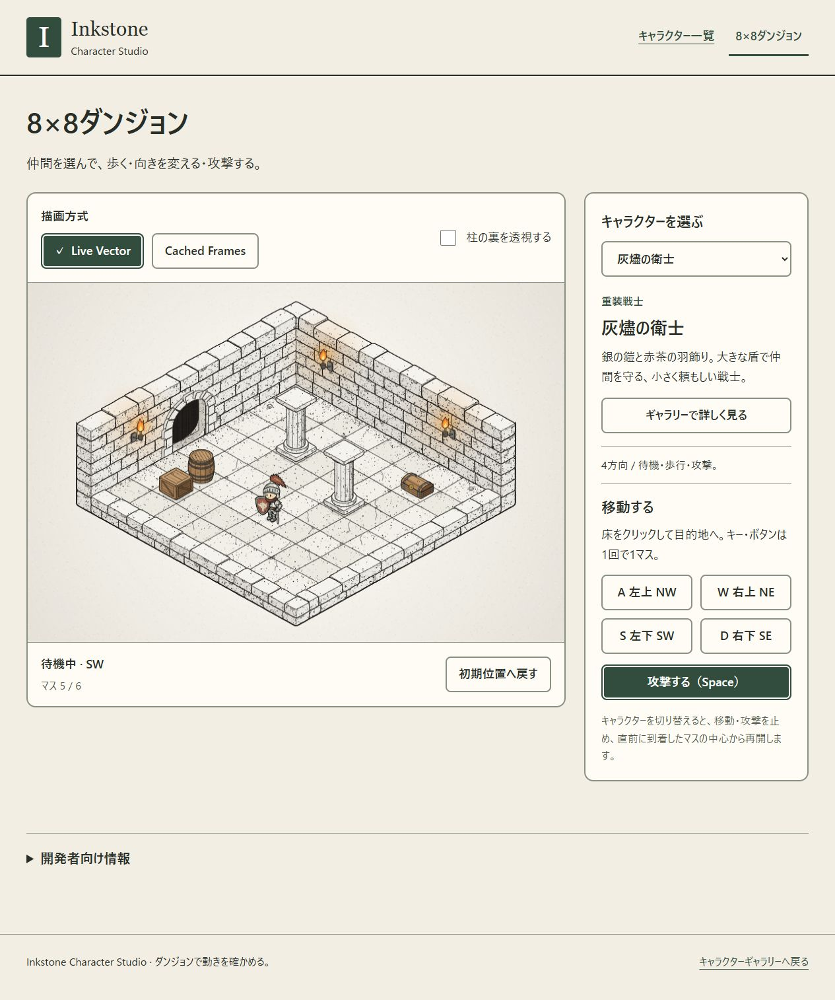

# Inkstone Character Studio 制作・検証報告

> この文書は制作時点の記録です。本文中の旧ファイル名・コマンド・起動先は当時のものを含みます。現在の構成と手順は [README](../../README.md) を参照してください。画像・資料への相対リンクは整理後の配置へ更新しています。

実施日: 2026-10-12（日本時間）。Windows / Node.js 24.13.1 / Chromium 155 / DPR 1。

## A. 完成したギャラリー

ルートをキャラクターギャラリーに変更しました。剣士、弓使い、骸骨、灰燼の衛士の4体を登録しています。カードから詳細へ進み、方向・動作・再生/停止・0.5/0.25倍スロー・位相・拡大/通常サイズ・Live/Cachedを操作できます。4方向、全方向×全動作は必要なときだけ展開します。

骸骨は `directional:false`、`idle` のみです。方向ボタン、歩行、攻撃、4方向一覧は表示しません。追加の完成キャラクターは制作していません。



[重装戦士の詳細画面](assets/studio/warrior-viewer.jpg) / [4方向×3動作](assets/studio/warrior-all.jpg)

## B. フォルダと役割

| 場所 | 役割 |
|---|---|
| `src/` | 既存Inkstone。今回の変更なし |
| `characters/warrior/character.js` | 重装戦士の唯一の保守対象ソース。描画と最小メタデータ |
| `game/characters/warrior.js` | 旧importを維持するre-exportのみ |
| `characters/builtins.js` | 既存3体の表示名・説明・出力元を関連づける |
| `characters/metadata.js` | 公開定義検査と、ID重複・メタデータの検査 |
| `characters/catalog.js` / `catalog.generated.js` | アプリの唯一のカタログ入口と生成された追加定義のimports |
| `studio/gallery.js` / `viewer.js` / `app.js` / `style.css` | 静止画一覧、詳細、ハッシュルーティング、読みやすい画面 |
| `game/index.html` | カタログ共通の8×8操作確認。既存の経路探索・衝突判定を再利用 |
| `tools/sync-catalog.mjs` | 制作時のファイル探索・検査・静的カタログ生成 |
| `tools/export-game.mjs` / `lib/module-files.mjs` | 選択定義と相対import依存の持ち出し |
| `start-studio.bat` / `tools/start-studio.mjs` | カタログ更新を含む起動経路 |
| `studio/verification/` | 再実行できる検査ページ・Nodeテスト・今回の証跡 |

過去の造形比較用スナップショットは実験証跡として残しました。現在のギャラリーとゲームはそのコピーを参照しません。エクスポートにも含めません。

## C. 新キャラクターの登録

1. `characters/<slug>/character.js` に既存Inkstone CharacterDefinitionを `character` としてnamed exportします。
2. `studio` に `name`、`category`、`description` を記述します。任意の代表方向・位相も設定できます。
3. `node tools/sync-catalog.mjs` を実行し、生成ファイルを保存します。
4. ブラウザを再読み込みしてカードと詳細を確認します。

動作・周期・コマ割り・frameBox・描画関数はCharacterDefinitionから取得します。依存モジュールはソースの静的な相対importを正とし、別の手書き依存リストを維持しません。ブラウザでフォルダ探索は行いません。

実検証では、既存骸骨描画を使う仮定義 `registration-check` を追加し、5体目のカードと待機のみの詳細画面がUI無変更で現れました。検証後に仮定義を削除し、4体へ再生成しました。重複ID、メタデータ不足、古い生成ファイル、未対応の部分方向定義のエラーをNodeテストで確認しました。

方向ありのキャラクターには現在4方向すべてを要求します。これは既存キャッシュが4方向を一括生成する制約を曖昧にしないためです。

## D. ゲームへの持ち出しと実検証

```sh
node tools/export-game.mjs --characters warrior,archer
```

`exported-game-kit/` に生成済みです。既存出力は上書きしないため、再実行時は `--out ./別の新規フォルダ` を指定してください。

共通 `src/` 全体、選択した追加定義、依存モジュール、`characters/register.js`、Rendererの小さな部屋サンプル、起動サーバー、説明書を出力します。内蔵3体は `src/index.js` の静的依存として全体に含まれますが、サンプルへ登録するのは選択した定義だけです。未選択の追加定義・Studio UI・カタログ・検証画像は含めません。

生成フォルダをルートとする別サーバーを8091番で起動しました。Studio側は8081番です。キットの弓使いと重装戦士を切り替え、Live/Cachedと動作変更、Rendererの実描画を確認しました。警告0、コンソールerror/warnなし。元のStudioへのimportはありません。検証用8091サーバーは作業終了時に停止しています。



さらに一時ディレクトリのテストで、選択した追加定義だけの出力、共有モジュールの再帰コピー、独立した登録コードのimport、既存出力拒否、未登録ID拒否、保護対象ソースへの出力拒否を検査しました。動的import、require、外部importは対象外としてエラーにします。

## E. 既存ライブラリと造形の維持

- `src/` は29ファイルすべて、保存済みSHA-256との一致を確認しました。変更0です。
- 重装戦士は移設とStudioメタデータの追加だけです。前回の最終修正（頭部z=66、0.9倍、首元装甲）を含む描画ソース全体を、前回の比較資料から復元した最終状態と照合しました。
- 旧戦士importと新しいcanonical importが同じ定義オブジェクトを返すことも確認しました。
- 部屋描画、共通リグ、キャッシュ、奥行き処理を再実装していません。

再利用した公開APIは `createCharacterView`、`createRenderer`、`registerCharacter`、`validateCharacter`、`frameKeysOf`、`DIRECTIONS`、描画方式・倍率・resize・diagnostics・dispose関連のAPIです。重装戦士の既存 `authoring.js` 利用も維持しています。

## F. 描画負荷とキャッシュ

一覧は画面近くのカードをLiveで一度だけ描画し、CharacterViewを即解放します。アニメーションキャッシュは0枚です。4体を閲覧した際の描画合計は4.4msでした。既存4体を繰り返した40カード試験では、初回は3枚だけ・14.3ms、末尾へジャンプ後は累計4枚・22.8msで、全40体の全動作生成は発生しませんでした。この値は単発観測で、通信・初回モジュール読込を含む全ロード時間ではありません。

詳細画面は選んだ1体のキャッシュだけを生成します。一覧展開も1つのCharacterViewを共有し、12セルそれぞれにアニメーションキャッシュを作りません。画面離脱・一覧を閉じる・Liveへ戻す際に適切なビュー/キャッシュを解放します。Live切替後にキャッシュ0枚・0 bytesを確認しました。

全キャラクター検査の実測（倍率1、DPR1、キャラクター画像分のRGBA理論容量）:

| ID | コマ数 | 理論容量 bytes | 生成時間 |
|---|---:|---:|---:|
| swordsman | 160 | 13,639,680 | 85.6ms |
| archer | 184 | 15,685,632 | 130.4ms |
| skeleton | 16 | 758,784 | 6.2ms |
| warrior | 240 | 26,254,080 | 357.8ms |

拡大2.2倍の戦士は127,344,000 bytes（約121.44MiB）、401.6msでした。診断のtotalには小さな共通画像分も含まれます。これは幅×高さ×4の理論値であり、ブラウザ/GPU実メモリではありません。

既存キャッシュはキャラクター単位で全方向・全動作を同期生成します。動作単位の遅延生成や非同期構築は今回 `src/` を変更せず実現できません。高倍率での初回停止、一覧展開時の追加キャッシュは残ります。通常はLive、必要時だけCachedを選べます。

静止画カードは閲覧した分だけ保持され、画面離脱で解放します。1枚360×310で約0.43MiB、40枚すべて閲覧すると画像の理論容量は約17MiBです。全定義モジュールは静的importで読み込みます。数百体への増加ではモジュール遅延読込やページングを検討すべきです。実ヒープ/GPUメモリ計測は未実施です。

## G. UIと機能の検証

本文18px、説明18〜20px、見出し26〜44px、補足16px。操作ボタンは実測最小53.69pxでした。選択を濃緑・白枠・太字・チェック印で示し、キーボードフォーカスも明示しています。FPSや容量は開発者向けの折りたたみに収納しました。

主要テキストの計算コントラスト比は墨色/生成り12.02:1、補足色/生成り6.04:1、緑/生成り8.01:1、白/緑9.27:1です。全面的なアクセシビリティ認証を意味するものではありません。

実ブラウザでカード→詳細、全4体、方向・動作、位相停止、スロー選択、Live/Cached、拡大/通常、4方向・12姿勢の展開/閉鎖、一覧への復帰を操作しました。キャラクターと装備が切れないことを目視確認しました。詳細は広い画面で方向/動作を絵の右側に置き、狭幅で下へ再配置します。

125%・150%・200%相当（CSS viewport 1012/843/632px）と360px幅で、文字を縮めず操作を再配置しました。ギャラリーと詳細の両方で横スクロールや操作領域の横はみ出しは0。200%相当で攻撃・位相を実際に操作しました。縦スクロールで全操作に到達できます。

**検証上の制限:** 使用したin-app browserではズームキーとviewport指定が本体の表示倍率に反映されませんでした。そこで同じ実ブラウザ内のiframeに指定CSS viewportを与え、表示を1.25/1.5/2倍に拡大する検証ページを使いました。これは再配置・可読性の相当試験です。Chrome/Edge本体の125/150/200%ズーム設定そのものは未確認として残します。

[200%相当での操作画面](assets/studio/reflow-200.jpg) / [再配置の測定結果](assets/studio/reflow-results.json)

技術検証:

| 検証 | 結果 |
|---|---|
| `npm test` | 16項目成功（既存ゲーム9、登録/出力等7） |
| カタログ `--check` | 正式4体、生成内容一致 |
| 全登録キャラクターのLive/Cached | Live 1,200姿勢、Cached 600コマ、空描画0・frameBox超過0 |
| キャッシュ解放 | 検査した4体すべて解放後0枚 |
| 既存 `check.html` | 51成功、0失敗。左右装備、関節、4方向×3動作、部屋、柱の実ピクセル遮蔽を含む |
| 移設したゲーム | W移動、Space攻撃、床クリック経路移動、到着後の待機を実操作確認 |
| エクスポート | 別ディレクトリ・別ポートで描画、警告0 |

画素検査はcache keyと中間位相のサンプリングで、無限に連続する全位相の証明ではありません。機能検査の成功と美術品質は区別しています。低視力の実利用者による主観評価・スクリーンリーダーの実機試験は未実施です。過去の技術検査ページの文字サイズは従来仕様を保持しました。ダンジョン画面の視認性は下記の追加改修で統一しました。

## H. 今後の標準作業

参考画像・指示 → `characters/<slug>/character.js` → 共通リグで制作 → カタログ生成 → ギャラリーで拡大/通常・方向/動作確認 → frameBox/Cached検査 → キット出力 → 別ゲームで確認、の順に統一しました。

`docs/STUDIO_GUIDE.md` に制作AIへ渡す指示テンプレート、`docs/EXPORT_GUIDE.md` に登録コード・Live/Cached・コピー範囲・更新時の注意を記載しています。通常のキャラクター追加ではギャラリーのソース編集は不要です。

## I. 残る課題と未確認事項

- ブラウザ本体の125〜200%ズーム、実利用者の見やすさ評価は別途確認が必要です。
- Cachedの同期一括生成と高倍率の容量は既存エンジンの制約です。改善候補は動作/方向別生成、段階生成、キャッシュ共有です。今回はエンジンを変更していません。
- exportの依存探索は静的な相対ES Modulesに対象を限定した実装です。汎用JavaScriptパーサー/バンドラーではありません。動的import、require、外部アセット、複雑な特殊構文は追加対応が必要です。
- 実際のGitHub Pagesへの公開、Safari/Firefox、高DPR端末、数百体の実データ負荷は未検証です。相対パスとハッシュルートで静的配信できる構成にしています。
- 通常サイズは1.25倍を基準とします。カメラを縮小した8×8デモの最終画面サイズとは異なるため、ゲームへの組込時は実際のRendererで評価してください。

証跡: [全体描画結果](assets/studio/render-results.json)、[既存51項目](assets/studio/legacy-results.json)、[拡大キャッシュ](assets/studio/viewer-cache.json)、[40カード負荷](assets/studio/performance-results.json)、[コントラスト](assets/studio/contrast-results.json)。

## 追加改修: 共通ダンジョンへ統一（2026-10-12）

旧デモの「キャラクター工房」、拡大ポートレート、位相・再生・12姿勢一覧と、それらの専用キャッシュ・描画処理・CSSを削除しました。`game/main.js`、`game/index.html`、`game/style.css` は8×8ダンジョン専用です。造形確認はStudioの詳細画面へ集約しました。過去の比較画像・検証資料と、旧importの互換ファイルは継続して使用するため保持しています。

ダンジョンの選択肢は `characters/catalog.js` から生成します。追加キャラクターもカタログ更新だけで選べます。全キャラクターのStudio詳細から「ダンジョンで見る」を選ぶと `?character=<id>` を引き継ぎ、ダンジョンから詳細へ戻るリンクも選択に追従します。専用の `studio.demo` メタデータは廃止しました。

`game/game.js` に定義切り替えを追加しました。切り替え時は直前に到着した安全なマスの中心へ戻し、経路・攻撃・攻撃予約を解除します。攻撃の長さは各CharacterDefinitionから取得します。骸骨は待機姿勢で移動し、攻撃ボタンとSpace攻撃を無効にします。未対応であることを画面に明示し、描画エンジンのidleフォールバックを歩行・攻撃実装済みとして扱いません。

文字・色・基本操作をStudioのCSSと共通化しました。本文18px、補足16px、ボタン最小54px。マウス/タッチ用の4方向移動・攻撃ボタンを追加し、既存の床クリック・WASD・Spaceも維持しています。狭幅では操作パネルを下へ配置します。数値診断は折りたたみの中にあります。

今回追加して確認したこと:

- 4体×Live/Cachedの8条件で正しい定義を描画し、警告・エラー0。Cachedは選択した1体だけ、Live復帰時は0枚。
- 弓使いの移動中Space入力→攻撃予約→攻撃→待機、剣士のW入力と床クリック移動→待機、骸骨の待機姿勢移動と攻撃無効を実ブラウザで確認。
- ギャラリー詳細→ダンジョンの選択IDの引き継ぎを確認。
- 360px幅と200%相当のiframe再配置で本文18px・ボタン最小54px、横はみ出し0。ブラウザ本体のズーム設定については前述の検証制限が継続。
- Nodeテストは19項目成功。追加3項目は各定義の攻撃周期、移動/攻撃中の切り替え、idleのみのキャラクターの動作制限を検査。
- `src/` と既存キャラクターの描画関数・形状は変更していません。

[検証記録](assets/studio/dungeon-checks.json) / [200%相当の操作画面](assets/studio/dungeon-reflow-200.jpg)


